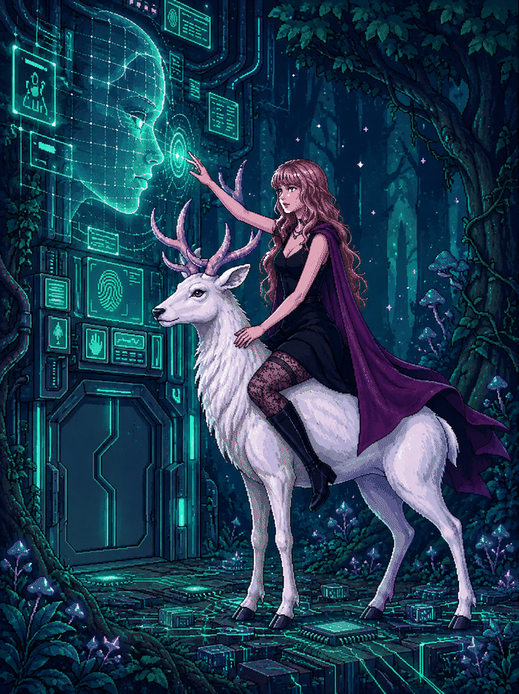

  

<h1 align="center">Hi, I'm Suheda Nur 👋</h1>

## 🌙 About Me

I'm a **Senior Computer Engineering student at Istanbul Arel University**, passionate about building
innovative solutions and exploring emerging technologies.

I've gained experience through internships at **Microsoft** and **Narbulut**. I'm also the founder
and president of the **Arel Cloud Computing Club** and a **Huawei Student Developers Campus Ambassador**.

I'm particularly interested in **Cloud Computing, Backend Engineering, AI/ML, NLP and Intelligent Systems** -
especially the part where a language model stops being a demo and has to survive real constraints,
validation and failure handling.

 

  

## 🚀 Projects

| Project | What it does | Tech |
|---|---|---|
| **[Cartena - Agentic Travel Engine](https://github.com/SuhedaNur4/Cartena-Agentic-Travel-Engine-Microsoft)** | Built during my **Microsoft summer internship**. Offline-first agentic engine that generates constraint-aware multi-city itineraries, validates them with deterministic rules and regenerates only the broken segments | Python · Local SLM · ChromaDB · RAG · State-graph orchestration · Docker |
| **[Briva](https://github.com/SuhedaNur4/Briva)** | AI-assisted volunteering platform matching volunteers with NGO events through a hybrid rule-based + LLM recommendation layer | Python · Flask · SQLAlchemy · SQLite · JWT · Gemini API |
| **[Satellite Water Bodies Segmentation](https://github.com/SuhedaNur4/Satellite-WaterBodies-Segmentation)** | Segments water bodies on satellite imagery using classical computer vision instead of a trained model | Python · OpenCV · NumPy · HSV · Otsu thresholding · Morphology |
| **[Architectural Style Classification](https://github.com/SuhedaNur4/architectural-style-classification)** | Classifies building photographs into architectural styles with a fine-tuned CNN | Python · PyTorch · EfficientNet-B3 · Transfer learning · Jupyter |
| **[MythosBalance](https://github.com/SuhedaNur4/MythosBalance)** | Activity tracking and life-balance platform that maps daily tasks onto five mythological life domains, with analytics and an admin panel | C# · ASP.NET Core 8 MVC · EF Core · SQLite · ASP.NET Identity · Bootstrap 5 · Chart.js |
| **[Event Registration System](https://github.com/SuhedaNur4/Event-Registration-System)** | Web app for managing event registrations with automated capacity checks and dynamic filtering | C# · ASP.NET Core 8 MVC · EF Core (Code-First) · SQLite · Razor · Bootstrap |
| **[Wine Database Management System](https://github.com/SuhedaNur4/Vivino-Style-Wine-Database-Management-System)** | Relational wine database demonstrating schema design, constraints and trigger-based business rules | MySQL · SQL · Triggers · Normalization |
| **[Rüya Günlüğü](https://github.com/SuhedaNur4/ruya-gunlugu)** | Dream journal with a layered REST API (route → controller → service → model), JWT auth and 26 unit tests | Node.js · Express · SQLite · JWT · Swagger · Jest · Vanilla JS SPA |
| **[Java Library Automation](https://github.com/SuhedaNur4/Java-Kutuphane-Otomasyonu)** | Fully offline library management system for village schools without internet access, shared by teachers and students on one terminal | Java 15 · Swing · SQLite · JDBC · SLF4J |

### 🤝 Collaborations

| Project | What it is | My contribution | Tech |
|---|---|---|---|
| **[Syntra](https://github.com/SuhedaNur4/Syntra)** | AI-powered operations platform that pulls stock, orders, supply and customer processes of small businesses out of spreadsheets and WhatsApp into one system. Built for the Artificial Intelligence and Technology Academy | Machine learning models, data analysis and Python components; worked with the team on code quality and model performance | Python · FastAPI · Streamlit · Pandas · Gemini API · Docker |
| **[Zaman Makinesi](https://github.com/SuhedaNur4/zaman-makinesi)** | 3D web game that teaches children the logic of coding: players travel through the Age of Dinosaurs, Ancient Egypt and space with a robot companion to collect the pieces of a broken time machine. Made with our student club for April 23rd Children's Day | Designed the glassmorphism UI/UX, integrated the 3D assets, built the grid-based command system and optimised loading with asset preloading | Three.js · JavaScript · WebGL |

  

## 🛠️ My Skillset

**Programming Languages**

**Cloud & Backend**

**AI & Machine Learning**

**Mobile & Frontend**

**Databases & Tools**

  

## 🧭 What I Work On

**Cloud & Backend**
- Huawei Cloud services (ECS, ModelArts) and cloud-based AI infrastructure
- REST APIs and backend services with Python, Flask, Express and ASP.NET Core
- Layered architectures, JWT authentication, API documentation and unit testing
- Relational schema design, constraints and trigger-based business rules

**AI, ML & Intelligent Systems**
- Model training and evaluation for predictive and vision tasks
- RAG pipelines, local LLM deployment and vector search
- Deterministic validation layers around generative output
- Classical computer vision: thresholding, morphology, segmentation

**Engineering Practice**
- Object-oriented design, data structures and algorithms
- Git-based workflows and modular, service-oriented architectures
- Leading a student tech community as founder of the Arel Cloud Computing Club

 

## 📊 GitHub Statistics

  
  

  

   

  

## 📫 Contact

Let's connect! Whether it's a collab, a question, or just nerding out over software stuff.

  
  
  

  

